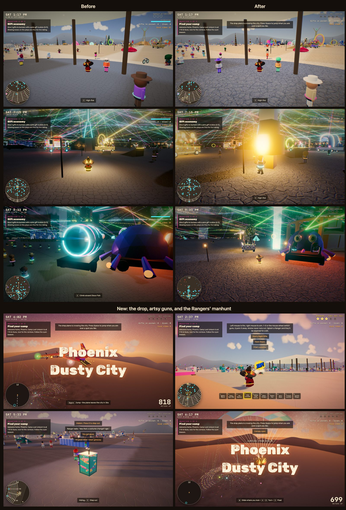

# Phoenix in the Dusty City

An open-world browser game set at a desert arts festival. You play Phoenix, a fiery bird-person the Rangers are looking for.

Every new week starts on a drop plane over the city. Jump, skydive, open your glider and land wherever you like. Pick up very artistic paint guns (unlimited ammo, nobody gets hurt), and stay one step ahead of the Dusty City Rangers by hiding in porta-potties, dancing in crowds and swapping costumes.

## Play it

- **In your browser, nothing to install:** https://composernyc.github.io/phoenix-in-the-dusty-city/
- **Downloaded, on a Mac:** on GitHub click **Code → Download ZIP**, unzip it, then double-click **Play Phoenix.command**. It starts a small local server and opens the game in your browser. Keep the Terminal window open while you play, and close it when you're done.
  - The first time, macOS may ask whether you want to open it. Right-click the file, choose **Open**, then **Open** again.
  - Opening `index.html` directly does not work, because browsers block the 3D models from loading from a plain file.
- **Downloaded, on Windows:** double-click **Play Phoenix.bat**. It needs Python installed (from python.org, or the Microsoft Store). If you don't have Python, just use the browser link above.
- Keyboard and mouse work best. Phones and tablets get touch controls.

Progress saves automatically in the browser you play in. The online and downloaded copies keep separate saves.

## Controls

| Key | Action |
|---|---|
| W A S D, mouse | Move, look (click to lock the mouse) |
| Space | Jump out of the plane, open your glider, jump. On a bike: hop |
| W while skydiving | Dive or glide toward where you look |
| Left / right mouse | Fire, aim (ammo never runs out) |
| 1–0, mouse wheel | Switch guns |
| Q | Put the gun away or take it out (radio when you drive an art car) |
| B | Call the drop plane and jump again (or step on a glowing launch pad) |
| E | Interact: hide in a porta-potty, change costume at a free closet, board, talk, gift, admire art |
| Shift | Run, pedal hard, floor the art car |
| V | Fly (only Phoenix can) |
| X | Melt time (after the Dream quest) |
| F · H | Flame cannons, horn |
| G | Dance (dancing in a crowd hides you from Rangers) |
| Tab | Phone: jobs, call the plane, gliders, outfits, stats |
| M · P · K · T | Map, pause and settings, photo mode, skip an hour |

## The Rangers

The stars at the top right are your wanted level, 0 to 5. Rangers see in a cone (shown on the minimap) and see less at night, in dust storms and in crowds. Splashing them stuns them for a while but raises your stars. To lose them, break line of sight and stay hidden: a porta-potty (unless they saw you go in), a dancing crowd, a new costume from a free closet, or a dust storm. More stars bring more Rangers, a truck, drones, searchlight towers and finally the blimp. If they catch you it's just a friendly chat at the Ranger outpost.

## What's in the folder

| File | What it is |
|---|---|
| `index.html` | Page, HUD and menus |
| `game.js` | The game: world, characters, vehicles, quests, flight, the drop, guns, the Ranger manhunt, crowds |
| `fx.js` | The look: height fog with sun glow, rim light, sky with the Milky Way, color grade |
| `weapons.js` | The ten artist guns, their projectiles, splats and sounds |
| `props.js` | Drop plane, gliders, porta-potties, Ranger drones, towers, blimp and outpost, launch pads, closets, camp decor |
| `dali.js` | Surreal Dalí creatures and set pieces |
| `masters.js` | Monet, Van Gogh, Picasso and Dalí art installations |
| `artcars.js` | Art cars after Van Gogh, Monet, Picasso and Dalí |
| `artcars2.js` | Art cars after Hokusai, Kahlo, Klimt, Mondrian, Kandinsky, Warhol, Haring, Kusama, Munch, Magritte, Matisse and Seurat |
| `assets/` | 3D characters, animations and vehicles (`.json`), sky images (`hdri/`) and textures (`tex/`) |
| `PLAN.md`, `PROGRESS.md` | The overhaul plan and what was done |
| `Play Phoenix.command` | Double-click launcher |

## Coming back to work on it

Open this folder in Claude Code and ask for what you want next. Ideas that came up:
- a longer story across the whole week
- more burner variety
- saving versions with git

## Credits

Characters and animations: KayKit by Kay Lousberg (CC0). Vehicles: Car Kit by Kenney (CC0). Skies and textures: Poly Haven (CC0). Engine: three.js. Everything else is generated in code. Full list in `CREDITS.md`.
